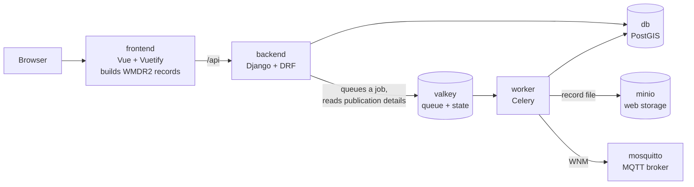

# wigos-node

## Introduction

A WIGOS node: a web application for managing the metadata of observing stations
and publishing via WIS2 infrastructure.

- Create and edit station records in a form validated against the schema.
- Change many stations at once in a spreadsheet, or through Excel and CSV files.
- Edit rights follow the issuer of each station's WIGOS identifiers.
- Each saved station is stored as a file in web storage and announced with a WIS2
  Notification Message (WNM) over MQTT.

Station records follow WMDR2, version 1.99dev2, using the JSON schema from
[wmo-im/wmdr2](https://github.com/wmo-im/wmdr2) (`wmdrRecordGeoJSON.yaml`, bundled).

## Architecture



| Service | Role | Port |
|---|---|---|
| `frontend` | Vite dev server for the Vue app | 5173 |
| `backend` | REST API and Django admin | 8000 |
| `db` | Stations, users and groups (PostgreSQL + PostGIS) | 5432 |
| `valkey` | Job queue, plus each station's last publication details | internal |
| `worker` | Runs the publishing jobs, with 4 processes | none |
| `minio` | Web storage for the record files | 9000, console 9001 |
| `mosquitto` | MQTT broker for the WNMs | 1883 |

**Publishing a station:**

1. Creating or changing a station through the API (the form or the batch wizard)
   sets its `publication_status` to `pending` and, after commit, queues a job with
   the station's id. Saves from the Django admin or the shell aren't published.
2. The worker takes the station's lock and publishes its current record: it stores
   the file, then sends the WNM. Several quick saves can result in one WNM.
3. The station ends as `processed` or `failed`. A failure removes the stored file,
   and a user can retry from the Publishing page. Retries are manual.

A failure to publish never fails the save. If Valkey can't be reached, the save
still goes through and the station stays `pending` until someone retries it.

Stations saved before publishing existed have no status. They show as Unknown,
aren't on the Publishing page and have no Retry, so saving them again is the only
way to publish them.

Publishers are configured in `PUBLISHERS` in `backend/config/settings.py`. Each is an
ordered list of steps, and each step pairs a generator with a transport. The list
is checked when Django starts.

## How to run

You need Docker with Docker Compose.

```sh
cp .env.example .env
docker compose up -d --build
# Optional: migrations already create the superuser admin / admin
# docker compose exec backend python manage.py createsuperuser
```

Then open:

- App: http://localhost:5173
- Django admin: http://localhost:8000/admin/
- MinIO console: http://localhost:9001

Migrations run when `backend` starts, which also refreshes the codelists from
codes.wmo.int and keeps the existing files if that fails. Migrations also create:

- a superuser, `admin` / `admin`, who owns the sample stations
- a test user, `test_user1` / `test_password1`, in the Switzerland and Brazil groups
- the sample stations in `test_data/`

> **Development only.** The defaults are not for production: the passwords and
> secret key in `.env.example`, the users created by migrations, Valkey with no
> password, and the Celery worker running as root.

The backend and frontend reload on code changes. The worker doesn't:

```sh
docker compose restart worker
```

**Tests:**

```sh
# Backend and publishing job
docker compose exec backend python manage.py test api publishing.django_tests
# Publishing plugins (in Git Bash on Windows, prefix with MSYS_NO_PATHCONV=1)
docker compose exec backend python -m unittest discover -s /publishing -t /publishing
# Frontend
docker compose run --rm --no-deps frontend npm test
```

**Frontend:** Node isn't needed on the host. After changing dependencies, rebuild the
image and renew its `node_modules` volume:

```sh
docker compose up -d --build -V frontend
```

**Editor setup (optional):** for code completion, create a Python 3.12 virtual
environment and install `backend/requirements.txt` and `publishing/requirements.txt`.

## Codebase tour

```text
backend/
  config/            Django settings and root URLs
  api/
    models.py        Station, users and issuer groups
    stations.py      Rules for creating and changing a station; asks for publication
    views.py         REST endpoints
    auth.py          Login endpoints for the frontend
    management/      populate_codelists command
    schemas/         WMDR2 JSON schema (keep identical to the frontend copy)
    codelists/       Cached WMO codelists
publishing/
  publishing/
    base.py          Plugin interfaces: Event, MessageGenerator, TransportLayer, Publisher
    registry.py      Builds publishers from settings
    publishers.py    The configured publishers, built once per process
    checks.py        Startup check of PUBLISHERS
    wmdr2.py         Renders a record as the published file
    generators/      Record file and WNM
    transports/      S3 storage, MQTT and a log transport for development
    celery.py        Celery app
    tasks.py         The publishing job and retry
    state.py         Locks and publication details in Valkey
    views.py         Publication API under /api/publications/
    django_tests.py  Tests that need Django
    tests/           Plugin tests, plain unittest
frontend/src/
  App.vue            Layout, sidebar and page switching
  api.js             Calls to the backend
  wmdr.js            Builds and cleans WMDR2 records
  components/        Pages and form fields, e.g. WmdrForm, StationsList, PublicationsPage
  components/batch/  Batch wizard and spreadsheet grid
  batch/             Batch operations and Excel/CSV import and export
  composables/       Shared logic: auth, codelists, WIGOS ID checks
  schemas/           WMDR2 JSON schema (keep identical to the backend copy)
mosquitto/           Broker configuration
test_data/           Sample records
docker-compose.yml   All services
```

The WMDR2 schema exists twice, in `backend/api/schemas/` and `frontend/src/schemas/`.
Change both together.

**Good places to start:**

- A station save: `backend/api/stations.py`, then `publishing/publishing/tasks.py`.
- A new publishing format or channel: add a generator or transport, then list it in
  `PUBLISHERS`.

## To do

- Batch operations are largely untested.
- Better logging to allow auditing, including whether to keep a history of station
  changes.
- Versioning of WMDR2 records.
- Using Keycloak to manage user sessions.
- Upstream confirmation of WNMs. It waits on the real broker, topic and credentials.
  Until then the WIS2 topic in `settings.py` is a placeholder and no station
  reaches `published`.
- Deleting stations, including the deletion WNM.
- Contacts shared between stations, in their own table.
- Edit rights for stations with WIGOS identifiers from two issuers: today they need
  both groups.
- Stations with WIGOS identifiers from special issuers, such as `0-20000-…`, need
  their edit rights assigned station by station, to an issuer group. Today these
  issuers aren't handled separately, and no group can edit such a station.

## License

Apache License 2.0. See [LICENSE](LICENSE).
